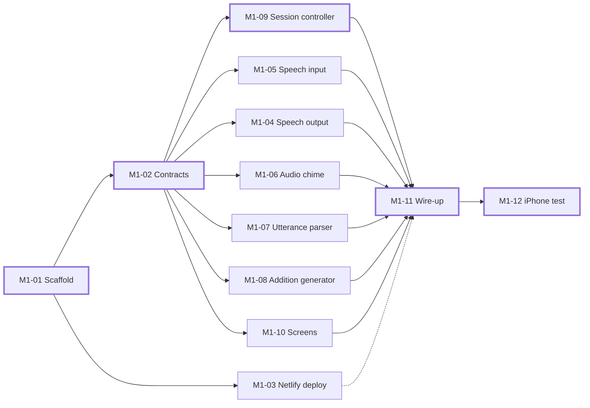

# Milestone 1 tickets: voice loop prototype (web)

Goal: on the iPhone in Safari, tap Start and do a hands-free 5-minute session of addition problems by voice.

Each ticket is one file in this folder. Update its `Status` line as work moves (`todo` → `in progress` → `done`). A ticket can start once every ticket in its `Depends on` line is `done`.

## Completion order

Twelve tickets finish in five waves; seven run side by side in wave 3.

| Wave | Tickets (run in parallel within a wave) |
| --- | --- |
| 1 | [M1-01 Scaffold](M1-01-scaffold.md) |
| 2 | [M1-02 Contracts](M1-02-contracts.md), [M1-03 Netlify deploy](M1-03-netlify-deploy.md) |
| 3 | [M1-09 Session controller](M1-09-session-controller.md) (start first), [M1-05 Speech input](M1-05-speech-input-adapter.md), [M1-04 Speech output](M1-04-speech-output-adapter.md), [M1-06 Audio chime](M1-06-audio-chime-adapter.md), [M1-07 Utterance parser](M1-07-utterance-parser.md), [M1-08 Addition generator](M1-08-addition-generator.md), [M1-10 Screens](M1-10-screens.md) |
| 4 | [M1-11 Wire-up](M1-11-wire-up.md) |
| 5 | [M1-12 iPhone test](M1-12-iphone-test.md) |

**Critical path:** M1-01 → M1-02 → M1-09 → M1-11 → M1-12. Finishing the contracts (M1-02) fast and starting the session controller (M1-09) first in wave 3 shorten the milestone most. M1-03 also gates the iPhone checks in M1-04 and M1-05.

To de-risk early, M1-05 (speech input) can start as a throwaway spike straight after M1-01 and be moved onto the contracts later.

**Out of scope for M1:** other operations, difficulty engine, spaced repetition, progress storage, method explanations.

## Questions for Conor

All decided; the answers are already reflected in the tickets.

- [x] **Harder and easier:** decided: removed. Difficulty is automatic, so the only commands are repeat and skip.
- [x] **Skip command:** decided: a spoken "skip" counts as missed, like the 20-second timeout.
- [x] **Score on screen:** decided: the session screen shows time left only, as in the canvas; the score comes in the end summary.
- [x] **Topic toggle:** decided: show the six-topic toggle from the canvas with Addition selected and the other five disabled until their milestones.
- [x] **Remember the voice:** decided: keep the voice choice in browser storage on the device (nothing leaves the device).
- [x] **Command count:** decided: two commands, repeat and skip; no "how am I doing", "harder" or "easier".

## References

- Technical decisions: https://claude.ai/artifact/DFQAUFRTTQHHc9CgghVc1g
- Screen designs: https://claude.ai/artifact/24bQQafT5F8GLjktMvAoTq
